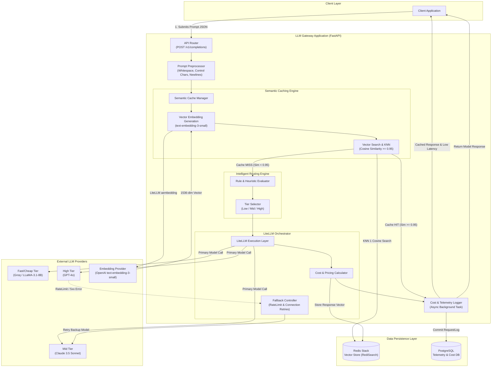

# System Architecture & Technical Specifications

This document outlines the architectural design, algorithmic heuristics, and technical decisions underpinning the **Cost-Optimized LLM Gateway**.

---

## 1. End-to-End System Architecture

The LLM Gateway acts as an intelligent reverse proxy, orchestration engine, and semantic cache seated between upstream client applications and downstream multi-provider Large Language Models.



---

## 2. Dynamic Routing Heuristics

### Why Rule-Based Heuristic Routing?
While machine learning classifiers can predict prompt complexity, they introduce non-trivial inference latency (30–100ms) and model drift risks. In high-throughput gateway infrastructure, a deterministic, rule-based heuristic engine offers sub-millisecond evaluation overhead (<0.5ms) and total operational predictability.

### Heuristic Rationale:
1. **Complexity Keywords (`target_tier: high_tier`)**:
   - **Keywords**: `synthesize`, `analyze`, `critique`, `evaluate`, `architect`, `benchmark`, `optimize`, `reason`.
   - **Rationale**: Prompts featuring these terms invariably demand multi-step reasoning, architectural synthesis, counterfactual analysis, or formal critique. Modern compact models (e.g. 8B parameters) suffer from hallucination and weak reasoning on these topics. Reserving Frontier models (`GPT-4o`) exclusively for these high-cognitive-load queries ensures enterprise-grade quality.
   
2. **Context Length Threshold (`target_tier: mid_tier`, threshold: 1,000 tokens)**:
   - **Rationale**: Prompts exceeding 1,000 tokens typically consist of large context ingestion (document summaries, multi-file code reviews, legal text parsing). Compact models often exhibit context degradation ("needle-in-a-haystack" degradation) beyond 1,000 tokens. Mid-tier models like `Claude 3.5 Sonnet` provide exceptional 200k-token context fidelity at 60% lower cost than frontier models.

3. **Default / Short Queries (`target_tier: low_tier`)**:
   - **Rationale**: Over 60% of enterprise queries are simple lookups, brief extractions, classifications, and basic translations. Modern ultra-fast models (`Groq / LLaMA-3.1-8B-Instant`) process these queries at 800+ tokens/sec for under $0.00008 per 1K tokens—producing a **98.4% cost reduction** compared to GPT-4o.

---

## 3. Vector-Based Semantic Caching Strategy

### The Inherent Flaw of Exact Matching
Traditional HTTP and database caches utilize exact cryptographic string matching (e.g., MD5/SHA-256 of the prompt string). In conversational AI, this leads to an abysmal cache hit rate (<5%):
- User A: *"How do I reset my account password?"*
- User B: *"What is the password reset process for my account?"*
- User C: *"How to reset password"*

All three users desire the identical underlying answer, yet exact hashing triggers three independent, expensive LLM completion calls.

### Conceptual Mechanics: Vector Embeddings & Cosine Similarity
1. **Vector Embedding Ingestion**:
   When a preprocessed prompt $P$ enters the gateway, it is transformed into a high-dimensional unit vector $\vec{u} \in \mathbb{R}^{1536}$ via OpenAI's `text-embedding-3-small`.
   
2. **Cosine Similarity Formulation**:
   The semantic similarity between prompt vector $\vec{u}$ and cached vector $\vec{v}$ is defined by the cosine of the angle between them:
   $$\text{Cosine Similarity}(\vec{u}, \vec{v}) = \frac{\vec{u} \cdot \vec{v}}{\|\vec{u}\|_2 \|\vec{v}\|_2} = \cos(\theta)$$
   Because normalized vectors are stored ($\|\vec{u}\|_2 = \|\vec{v}\|_2 = 1$), the cosine similarity simplifies to the direct dot product:
   $$\text{Cosine Similarity} = \vec{u} \cdot \vec{v}$$

3. **RediSearch KNN Indexing**:
   Redis Stack stores vectors in an HNSW (Hierarchical Navigable Small World) graph using the `COSINE` distance metric. RediSearch calculates cosine distance $D_{cos}$:
   $$D_{cos} = 1 - \cos(\theta)$$
   Our gateway computes the similarity as:
   $$\text{Similarity} = 1.0 - D_{cos}$$

4. **Threshold Selection ($\tau = 0.95$)**:
   - $\ge 0.95$: Near-identical semantic intent with negligible risk of false positives.
   - $0.90 - 0.94$: High topic correlation, but subtle nuances (e.g. "Python 2 vs Python 3") may yield inaccurate cached answers.
   - $< 0.90$: Conceptual overlap without semantic equivalence.
   A threshold of **0.95** balances enterprise accuracy with aggressive cache hits.

---

## 4. Fallback & Fault Tolerance Architecture

External LLM APIs routinely experience transient failures, network connection drops, and HTTP 429 Rate Limit spikes.

```
[Incoming Request]
       │
       ▼
[Execute Primary Model (e.g., GPT-4o)]
       │
       ├─────────────────────────────────┐
    Success                           Failure
       │                    (RateLimitError / 5xx)
       ▼                                 │
[Return Response]                        ▼
                            [Lookup Fallback Config]
                                         │
                                         ▼
                            [Execute Backup Model (e.g., Claude 3.5 Sonnet)]
                                         │
                                         ├────────────────────────┐
                                      Success                  Failure
                                         │                        │
                                         ▼                        ▼
                                 [Return Response         [HTTP 502 Bad Gateway
                                  with model_used]          Error Logged]
```

- **Retryable Exceptions**: `RateLimitError`, `APIConnectionError`, `ServiceUnavailableError`, `Timeout`, and `InternalServerError`.
- **Zero-Downtime Resilience**: Seamless model swap without client-side interruption; the response payload transparently notes the fallback model utilized.

